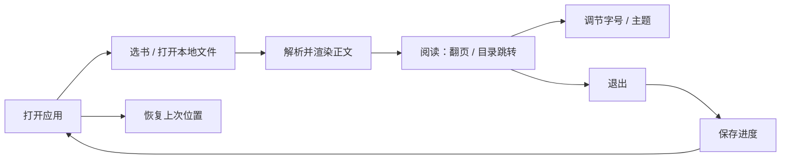

# 电子书阅读器 PRD（MVP）

## 1. 背景与目标

个人用户手中常有多份 EPUB / TXT 电子书，但缺少一个统一、专注、能记住阅读位置的桌面阅读工具。

- **用户**：在 Windows 桌面上阅读电子书的个人用户。
- **触发时刻**：想读一本书时，打开应用并选中本地书籍文件。
- **产品决策**：做一个只服务"阅读"这一件事的轻量本地阅读器，不做书库管理平台。
- **可观察目标**：用户能打开 EPUB/TXT 并从头读到尾；下次打开同一本书时，自动回到上次读到的位置。

> 技术前提（非产品约束，仅作背景）：C++ + Qt 桌面版（Windows）；EPUB 正文渲染基于 QTextDocument；支持 EPUB 2/3 与 TXT。

## 2. 范围

### P0 — MVP 必须

- 打开本地 EPUB / TXT 书籍
- 解析并渲染正文
- 目录导航 + 上一页 / 下一页
- 字号调节
- 主题切换（日间 / 夜间）
- 阅读进度自动保存与恢复

### P1 — 锦上添花（**不在本次 MVP 交付范围**，作为下一迭代）

- 最近打开的书列表
- 单书签（每本书一个位置标记）

> 本次 MVP 只交付 P0 六项与第 5 节的共享规则；P1 两项连同 `[TBD]` 项统一放到迭代二。

### 本版本明确不做

多格式（PDF / MOBI / AZW3）、划线批注与笔记、跨设备同步、查词翻译、自定义字体与精细排版、云端书库与 DRM。

## 3. 核心流程

阅读的闭环是：**打开 → 渲染 → 阅读导航 → 调节 → 退出 → 下次自动续读**。

## 4. 功能需求

| ID | 功能 | 触发 | 行为 | 规则与状态 |
|---|---|---|---|---|
| FR-01 | 打开书籍 | 用户点击"打开"，在文件选择器选中本地文件 | 识别格式（EPUB/TXT），解析成功后进入阅读视图 | 仅支持 `.epub` / `.txt`；解析失败给出提示并留在原界面，不崩溃 |
| FR-02 | 正文渲染与分页 | 书籍解析完成后自动执行 | 将内容排版渲染为可阅读正文，并按窗口大小分页 | 字号或窗口尺寸变化后需重新分页 |
| FR-03 | 阅读导航 | 用户点击目录项，或上一页/下一页按钮 | 跳转到对应章节或相邻页 | 首页不可再"上一页"、末页不可再"下一页"，越界时按钮呈禁用态 |
| FR-04 | 字号调节 | 用户在阅读界面调整字号 | 全局字号变化并立即重排正文 | 有最小值/最大值与步进范围（见第 5 节）；对所有书生效 |
| FR-05 | 主题切换 | 用户选择日间 / 夜间主题 | 背景与文字配色整体切换，立即生效 | 选择结果持久化，下次启动沿用 |
| FR-06 | 阅读进度记忆 | 阅读中位置变化时自动触发 | 记录当前书的位置（章节 + 页内偏移）；再次打开该书时自动恢复 | 进度按"每本书"独立保存；首次打开从书首开始 |
| FR-07 | 最近书列表（P1） | 应用启动或返回起始界面 | 展示最近打开过的书籍，可一键再次打开 | 记录打开时间倒序；条目支持移除 |
| FR-08 | 单书签（P1） | 用户在阅读中标记书签 | 记住当前位置，可跳转回该位置 | 每本书最多一个书签，可覆盖 |

### 补充说明（仅当交互不易从表中看出）

- **FR-02 / FR-04 的联动**：字号调整不是"缩放画面"，而是改变排版后重新分页，因此当前阅读位置应尽量保持在视觉上相近的内容处。
- **FR-06 与 FR-01 的联动**：打开书时先查是否有历史进度；有则恢复到该位置，无则从书首开始。

## 5. 共享规则与异常

**持久化范围**

| 数据 | 维度 | 说明 |
|---|---|---|
| 字号 | 全局 | 对所有书籍生效 |
| 主题 | 全局 | 对所有书籍生效 |
| 阅读进度 | 每本书 | 按书籍独立保存 |
| 最近书列表（P1） | 全局 | 按打开时间倒序 |

**编码处理**：TXT 需支持 UTF-8 / UTF-16 / GBK 的识别，无法识别时回退到 UTF-8 并提示。

**异常场景**：文件损坏、EPUB 结构缺失、编码无法识别 —— 一律给出明确提示，停留在原界面，应用不崩溃。

## 6. 已定稿的产品决策

- **已定稿**：正文形态采用**分页**（FR-02、FR-03 按分页语义落地）。
- **已定稿**：字号默认 **18px**，范围 **12–32px**、步进 **2**。
- **已定稿**：本版本**不显示**页码或百分比进度，保持极简阅读界面。
