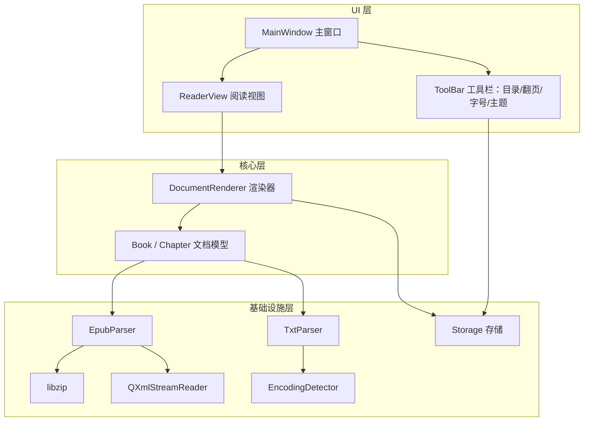
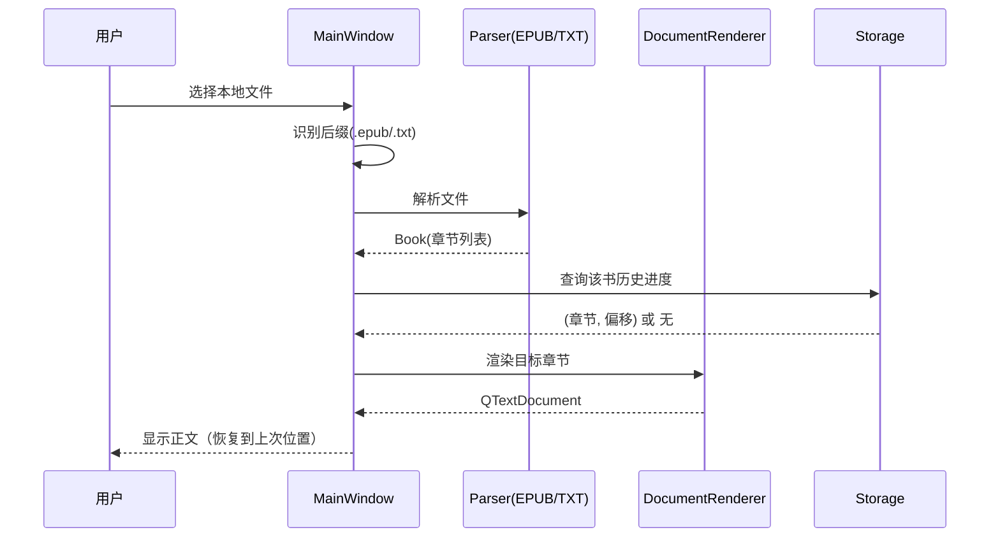

# 电子书阅读器 技术设计文档（TECH_DESIGN）

配套文档：[PRD.md](./PRD.md)（产品需求）。本文档只讲"怎么实现"，不重复产品需求。

## 1. 技术栈总览

| 层次 | 选型 | 版本 | 用途 | 选择理由 |
|---|---|---|---|---|
| 语言 | C++ | C++17 | 全部业务逻辑 | 标准已成熟稳定；`std::filesystem`、`std::optional` 等现代特性可用 |
| GUI 框架 | Qt | Qt 6.5（LTS） | 窗口、工具栏、阅读视图、文件选择器 | 跨平台、文档完善；信号槽机制适合阅读器的事件模型 |
| 构建系统 | CMake | ≥ 3.21 | 工程构建、依赖管理 | Qt6 官方推荐的构建方式 |
| 编译器 | MSVC | VS 2022 | Windows 平台编译 | 与 Qt 官方 Windows 包配套 |
| ZIP 解压 | libzip | ≥ 1.10 | 读取 EPUB（本质是 ZIP 容器） | Qt 无公开 ZIP 读取 API；libzip API 清晰、跨平台 |
| 底层压缩 | zlib | ≥ 1.2.11 | libzip 的依赖 | libzip 内部依赖，通常随 libzip 一并配置 |
| XML 解析 | QXmlStreamReader | Qt 内置 | 解析 `container.xml`、OPF、目录 | 流式解析、零外部依赖，体积和复杂度都最省 |
| 正文渲染 | QTextDocument / QTextBrowser | Qt 内置 | 将章节内容排版渲染为可阅读正文 | 轻量、内置；接受它只支持 HTML/CSS 子集 |
| 编码探测 | 自研 + QTextCodec(Core5Compat) | Qt 6 | 识别 TXT 的 UTF-8 / UTF-16 / GBK | GBK 在 Qt6 需引入 Core5Compat 模块 |
| 持久化 | QJsonDocument + 本地文件 | Qt 内置 | 保存阅读进度、偏好、最近书 | 结构化、易读写、便于后续扩展 |
| 测试（可选） | Qt Test | Qt 内置 | 对解析与进度逻辑做单元测试 | 解析逻辑独立于 UI，适合单测 |
| 版本控制 | Git | — | 代码管理 | 常规选择 |

> 外部依赖只有 **Qt + libzip(+zlib)**，其余解析与业务逻辑全部自己实现——这也是本项目的工程练习重点。

## 2. 架构与模块划分

采用**三层结构**：UI 层只负责展示与交互，核心层不含 Qt GUI 依赖，基础设施层提供解析与存储能力。



| 模块 | 职责 | 依赖 |
|---|---|---|
| MainWindow | 主窗口、菜单、打开文件入口、承载阅读视图 | Qt Widgets |
| ReaderView | 显示正文、接收翻页/跳转、上报当前位置 | QTextBrowser |
| ToolBar | 目录树、上一页/下一页、字号、主题控件 | Qt Widgets |
| Book / Chapter | 统一文档模型：元数据 + 章节列表 + 每章原始内容 | 无 |
| IDocumentParser | 解析器统一接口（格式无关） | 无 |
| EpubParser | 解压、解析 OPF/manifest/spine/目录 | libzip、QXmlStreamReader |
| TxtParser | 读取文本、调用编码探测、切分为单章 | EncodingDetector |
| DocumentRenderer | 由章节内容构建 `QTextDocument`，负责样式与分页 | QTextDocument |
| Storage | 读写阅读进度、偏好、最近书 | QJsonDocument |
| EncodingDetector | 识别 UTF-8 / UTF-16 / GBK | QTextCodec |

## 3. 关键设计决策

### 3.1 统一的文档模型（最重要）

不论 EPUB 还是 TXT，解析后都产出**同一种** `Book` 结构：元数据（书名、作者）+ `Chapter` 列表（标题 + 内容）。上层渲染器、目录、翻页逻辑只面向这个模型，完全不感知来源格式。

好处：新增格式只需再写一个 Parser 实现，UI 与渲染层零改动——这也是把"格式支持"和"阅读体验"解耦的关键。

### 3.2 为什么用 QTextDocument 而不是 Qt WebEngine

WebEngine 基于 Chromium，能完整渲染 HTML/CSS，但会让安装包体积和内存占用暴涨，且引入大量与阅读无关的复杂度。QTextDocument 支持的 HTML/CSS 子集足以覆盖正文、标题、段落、基础样式与图片，MVP 阶段是明显更优的取舍。

### 3.3 阅读进度的定位方式（章节 + 偏移，而非页码）

字号或窗口变化会**触发重新分页**，页码会随之改变，因此"记住第几页"是不稳定的。进度改用 **（章节索引 + 章内字符偏移）** 保存；恢复时把该偏移映射回当前排版下的页码。这样无论字号怎么调，都能回到大致相同的内容位置。

### 3.4 书籍身份识别

MVP 用 **规范化绝对路径**（配合文件大小/修改时间做辅助校验）作为一本书的唯一标识，用于关联进度与最近书。代价是文件移动后进度会失联——这是 MVP 接受的取舍，内容哈希方案留待后续。

### 3.5 正文形态：分页（已定稿）

PRD 第 6 节已拍板采用**分页**。"页"的边界取阅读视图的**视口高度**：`ReaderView` 基于 `QTextBrowser`，翻页即按滚动条 `pageStep`（等于视口高度）整屏位移；首页 / 末页通过滚动条的 `minimum` / `maximum` 判定，据此禁用对应的上一页 / 下一页按钮（FR-03）。

字号或窗口尺寸变化会改变排版与页边界（FR-02），此时按"章节 + 章内字符偏移"重新定位（见 3.3），而不是记忆页码。

> 实现细节：渲染器 `DocumentRenderer` 产出的是 `QTextDocument` 可直接识别的 HTML 片段（含字号与行高样式），由 `ReaderView` 写入其自身文档。这样文档所有权始终归属视图，避免 `setDocument` 带来的生命周期歧义。

### 3.6 界面样式方案：深度定制（已定稿）

产品侧选定"深度定制"路线，分三层推进，每层独立可验证：

1. **主题与样式系统**：颜色集中在 `ColorScheme`（日间暖白 / 夜间深灰两套预设），样式表以模板形式存于 `resources/theme.qss`，颜色位置用 `@token@` 占位，运行时由 `Theme::buildStyleSheet()` 替换后交给 `QApplication::setStyleSheet()`。样式表经 Qt 资源系统（`resources/resources.qrc`）打包，避免运行期文件路径依赖。
2. **阅读区舒适度**：正文留白、行高、字号、极简滚动条统一由样式表控制。这是阅读体验的关键，优先于装饰性效果。
3. **窗口外观进阶（已实现）**：`MainWindow` 设 `Qt::FramelessWindowHint` + `WA_TranslucentBackground`，外层留白容纳阴影，内层 `#windowFrame`（`QFrame`）承载背景与圆角并挂 `QGraphicsDropShadowEffect`；菜单栏 / 工具栏改为内嵌在该容器内。`TitleBar`（`src/ui/TitleBar.{h,cpp}`）自绘标题栏，负责拖动移动、双击最大化/还原，并发出最小化 / 最大化 / 关闭信号——关闭信号仍走 `MainWindow::closeEvent`，进度落盘链路不变。边缘缩放在 `MainWindow` 的事件过滤器里按 8 个方向命中判定实现。过渡动画三项：窗口出现淡入、主题切换淡出→换肤→淡入、翻页按滚动条值做 `QPropertyAnimation` 滑动。

> 采用**纯 Qt 方案**而非 Win32/DWM 原生方案：跨平台、不引入平台 API；代价是不支持 Win+方向键贴边等系统行为，MVP 可接受。
>
> **不使用 QML**：AGENTS.md 已把 Qt Widgets 定为硬约定；本项目界面 90% 是文本排版，Widgets 足以胜任，换栈会推翻既有技术设计。

### 3.7 EPUB 的解析与正文取法（已定稿）

EPUB 本质是 ZIP 容器，解析链路固定为三段：`META-INF/container.xml` 取 rootfile → OPF 取 `metadata` / `manifest` / `spine` → 按 spine 顺序逐个读取内容文档。三段都用 `QXmlStreamReader` 流式解析，解压用 libzip。

**章节的划分**：`spine` 里的每个 `linear` 条目对应一个 `Chapter`（`linear="no"` 的封面 / 广告页不进入正文）。OPF 里的 `href` 以 OPF 自身所在目录为基准解析，并去掉 `#fragment` 与百分号转义——这是 EPUB 里最容易出错的一步。

**正文的取法**：内容文档（XHTML）交给 `QTextDocument` 解析后取 `toPlainText()`，而不是把 HTML 直接透传给渲染器。两个理由：一是 `QTextDocument` 对实体引用（如 `&nbsp;`）和不闭合标签都宽容，而 `QXmlStreamReader` 遇到未声明实体会直接报错；二是书内自带的 CSS 若原样透传，可能把正文设成固定黑字，在夜间主题下不可读——取纯文本后配色完全由本应用的主题系统掌控。

代价是粗体 / 斜体 / 图片等内联样式丢失，只保留段落结构（见第 9 节风险）。

**章节标题**：优先取内容文档里第一个标题块（`h1`–`h6`），其次 XHTML 的 `<title>`，最后用文件名兜底。

### 3.8 目录导航的实现口径（已定稿）

目录直接来自 `Book::chapters`（即 spine 顺序），不额外解析 EPUB 自带的 `toc.ncx` / `nav.xhtml`：MVP 下「一章 = 一个内容文档」，二者条目基本重合，省掉一层解析与嵌套层级的映射。代价是失去书籍自带目录的多级结构与同文档内的锚点跳转，留待后续。

UI 形态为**左侧可折叠面板**（`QListWidget`）+ 工具栏「目录」开关：多章节书籍打开时默认展开，单击条目跳到该章开头，当前章节高亮随阅读位置同步。

**跨章翻页**：`ReaderView` 原先只在一个章节内滚动，多章节书会卡在第一章末尾。现在由 `MainWindow` 判定：视口未到本章底部就正常翻页，已到底部则切到下一章开头；已在本章顶部再上翻则回到上一章末尾（`ReaderView::showChapter` 以负偏移表示章末）。按钮可用性同时考虑「本章内能否滚动」与「是否存在相邻章节」。

### 3.9 TXT 编码识别（已定稿）

按 PRD 第 5 节支持 UTF-8 / UTF-16 / GBK，识别顺序与判据如下（实现见 `src/utils/EncodingDetector.{h,cpp}`）：

| 顺序 | 判定手段 | 判据 |
|---|---|---|
| 1 | BOM | `EF BB BF` / `FF FE` / `FE FF` → UTF-8 / UTF-16LE / UTF-16BE，最可靠，同时把 BOM 从正文剔除 |
| 2 | 无 BOM 的 UTF-16 启发式 | 前 512 字节内 `0x00` 规律地集中在奇数或偶数下标 → UTF-16LE / UTF-16BE |
| 3 | 严格 UTF-8 | `QStringDecoder(Utf8)` 解码后 `hasError()` 为假才接受；GBK 字节几乎必然触发非法序列 |
| 4 | 严格 GBK | `QTextCodec::codecForName("GBK")` 配 `ConverterState::invalidChars == 0` 才接受 |
| 5 | 回退 | 都不成立则按 PRD 回退 UTF-8（非法字节替换为 U+FFFD），并置 `reliable = false` |

第 4 步的 GBK 编解码器由 Qt6 的 **Core5Compat** 模块提供（不是 `QStringDecoder`）。已在本机实测：`QTextCodec::availableCodecs()` 含 `GBK` / `CP936` / `GB18030`，`QStringDecoder(Utf8)` 解 GBK 字节时 `hasError()` 为真，两条判据都成立。

**已知取舍**：无 BOM 且以中文为主的 UTF-16 文本几乎不含 `0x00`，第 2 步识别不了，会落到第 4 步按 GBK 处理。实际保存 UTF-16 的文件绝大多数带 BOM，MVP 可接受。

**分层**：`EncodingDetector` 只依赖 QtCore，不产出界面文案；`TxtParser` 把「已回退」这一事实写进 `Book::encodingFallbackUsed`，提示文案由 `MainWindow` 用 `tr()` 给出（核心层与 UI 层职责不混）。

验证夹具（可复现）：`build/sample_utf8.txt`（UTF-8 无 BOM）、`sample_gbk.txt`（GBK）、`sample_utf16.txt`（UTF-16LE 带 BOM）、`sample_junk.txt`（非法字节，用于走回退分支）。

## 4. 关键流程

**打开书籍**



**退出与续读**：阅读中位置变化 → 实时写入进度文件（带节流）；下次打开同一本书 → 读取进度并恢复。

## 5. 数据存储设计

统一存到一个本地 JSON 文件（路径见下），结构示意：

```json
{
  "settings": { "fontSize": 18, "theme": "day" },
  "books": [
    {
      "path": "D:/books/example.epub",
      "size": 1234567,
      "lastOpened": "2026-10-19T20:30:00",
      "progress": { "chapterIndex": 3, "charOffset": 1820 }
    }
  ]
}
```

| 数据 | 维度 | 说明 |
|---|---|---|
| `settings.fontSize` / `settings.theme` | 全局 | 对所有书生效 |
| `books[].progress` | 每本书 | 章节索引 + 章内字符偏移 |
| `books[]` 列表 | 全局 | 按 `lastOpened` 倒序即"最近书列表" |

存放位置：Qt 标准配置目录（`QStandardPaths::AppDataLocation`），避免写死在工程目录里。

## 6. 工程目录结构

```text
Reader/
├── CMakeLists.txt
├── src/
│   ├── app/            # main.cpp、MainWindow
│   ├── ui/             # ReaderView、ToolBar、设置面板
│   ├── document/       # Book.h、Chapter.h、IDocumentParser.h
│   ├── parsers/        # EpubParser、TxtParser
│   ├── render/         # DocumentRenderer
│   ├── storage/        # Storage（进度/偏好/最近书）
│   └── utils/          # EncodingDetector
├── third_party/        # libzip（或通过包管理器引入）
└── resources/          # 图标、样式表
```

## 7. 依赖与构建要点

- Qt6 组件：`Qt6::Widgets`、`Qt6::Gui`、`Qt6::Core`，TXT 编码用到 `Qt6::Core5Compat`。
- libzip：Windows 上通过 vcpkg 引入（它自身依赖 zlib）。本项目实际落地的步骤：

  ```bash
  git clone --depth 1 https://github.com/microsoft/vcpkg.git D:/true_etc/vcpkg
  D:/true_etc/vcpkg/bootstrap-vcpkg.bat -disableMetrics
  D:/true_etc/vcpkg/vcpkg.exe install libzip:x64-windows
  ```

  安装的是**动态三元组 `x64-windows`（/MD）**，与 Qt 官方包一致；不要用 `-static`（/MT），否则链接期会因运行库不匹配失败。
- CMake 用 `find_package(Qt6 ...)` 定位 Qt，用 `find_package(libzip CONFIG REQUIRED)` + `target_link_libraries(... libzip::zip)` 接入 libzip；configure 时必须带上 toolchain 文件：

  ```bash
  cmake -S . -B build -G "Visual Studio 17 2022" -A x64 \
        -DCMAKE_PREFIX_PATH=<Qt6 安装路径> \
        -DCMAKE_TOOLCHAIN_FILE=D:/true_etc/vcpkg/scripts/buildsystems/vcpkg.cmake
  ```
- 运行期依赖 DLL 由 vcpkg 的 toolchain 自动部署到可执行文件目录（Debug 配置下取自 `installed/x64-windows/debug/bin`，实际文件名是 `zip.dll`、`zd.dll`、`bz2d.dll`），无需手工复制。
- 建议尽早把构建跑通、能弹出一个空窗口，再往里填逻辑。

## 8. 构建顺序（里程碑）

1. **最小闭环**：只读 UTF-8 TXT，能显示文字 + 上一页/下一页 —— 已完成
2. **阅读状态**：字号、主题、进度的保存与恢复 —— 已完成
3. **EPUB**：解压 + 解析 OPF + 目录 + 渲染 —— 已完成（实现见 3.7 / 3.8），已用真实 EPUB 验证
4. **收尾**：TXT 编码探测 —— 已完成（见 3.9）；最近书列表与单书签属 P1，留作**迭代二**（PRD 第 2 节）

第 1 步刻意选 TXT，是为了在不引入 libzip/XML 复杂度的情况下，先把"模型 → 渲染 → 视图 → 存储"这条主链路打通。

## 9. 风险与开放问题

| 项 | 说明 |
|---|---|
| EPUB 排版还原度 | QTextDocument 只支持 HTML/CSS 子集，复杂排版的书样式可能丢失，MVP 接受 |
| EPUB 正文形态 | 现阶段取纯文本（3.7），粗体 / 斜体 / 图片不保留；后续若要做富文本，需给 Chapter 增加「内容是 HTML」的标记并扩展渲染器 |
| 目录完整性 | 目录取自 spine 顺序（3.8），不含书籍自带 toc.ncx / nav.xhtml 的多级结构与锚点跳转 |
| libzip 的 Windows 构建 | zlib 依赖可能带来构建摩擦，建议用 vcpkg 统一管理 |
| 分页 / 滚动 | 待 PRD 定稿，直接影响 ReaderView 实现 |
| 进度稳定性 | 字符偏移方案在字体/排版变化大时可能有小幅漂移，可接受 |
